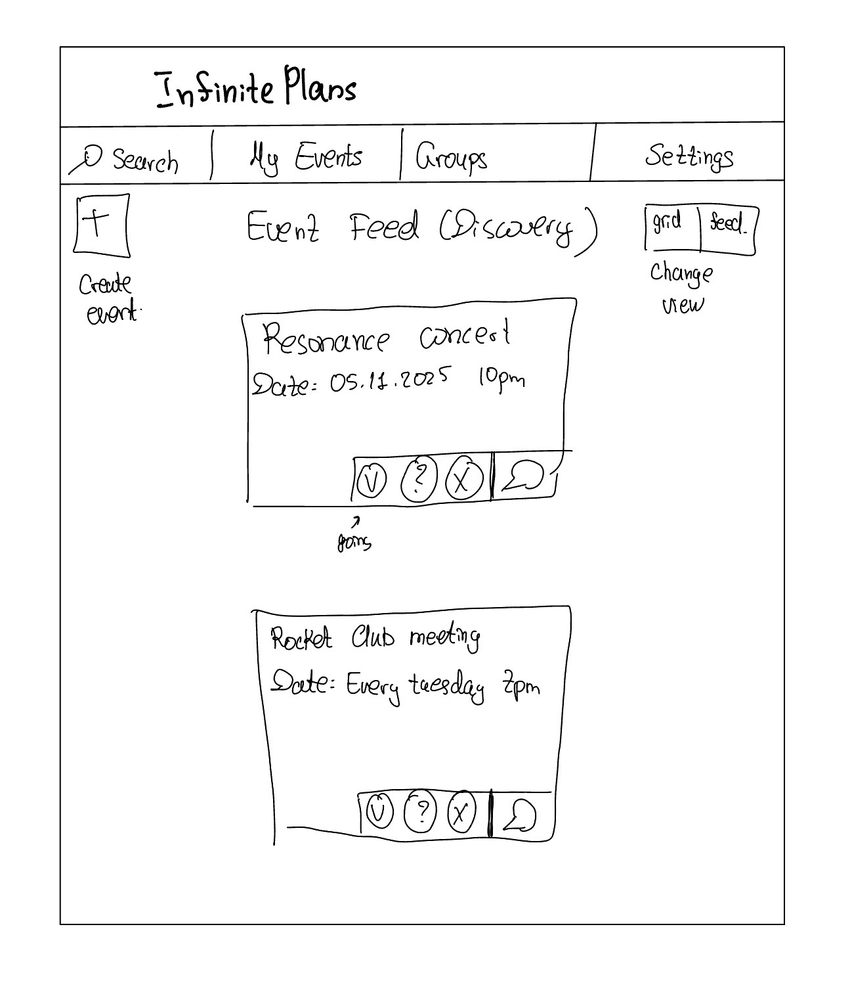
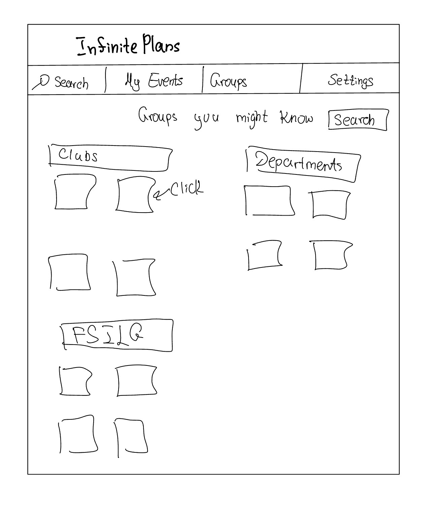
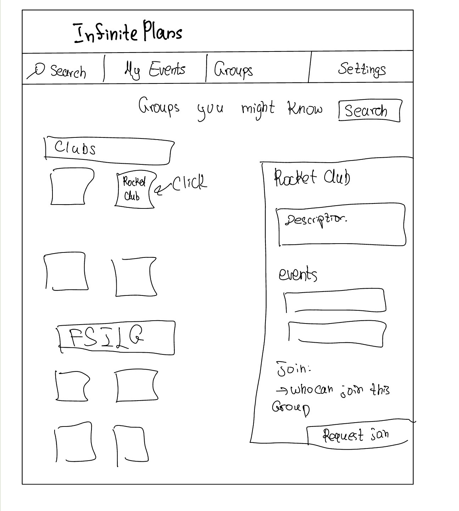
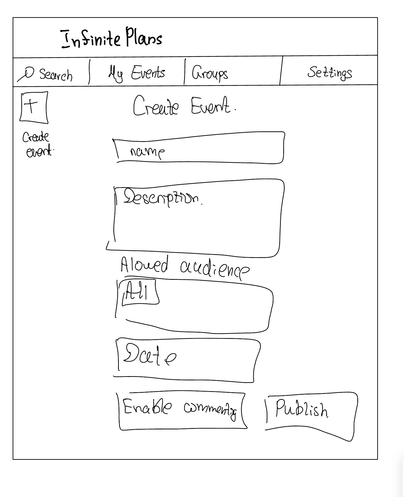
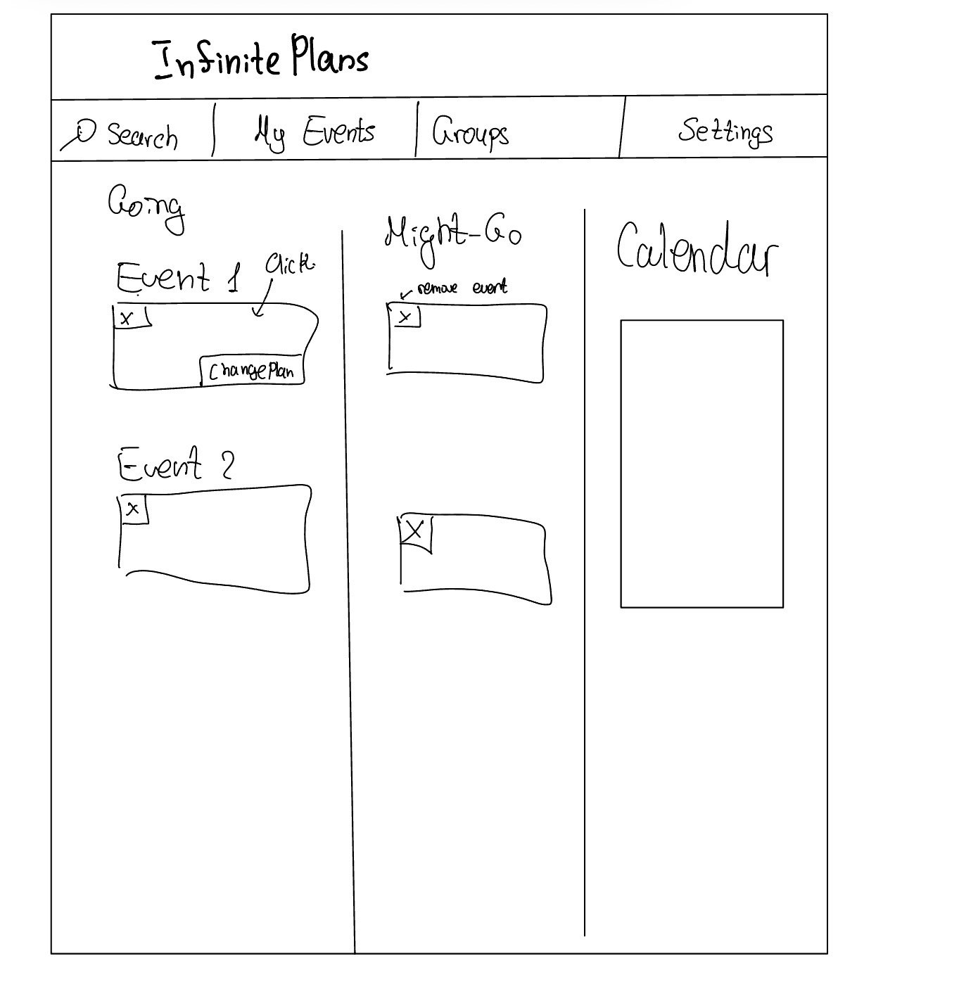
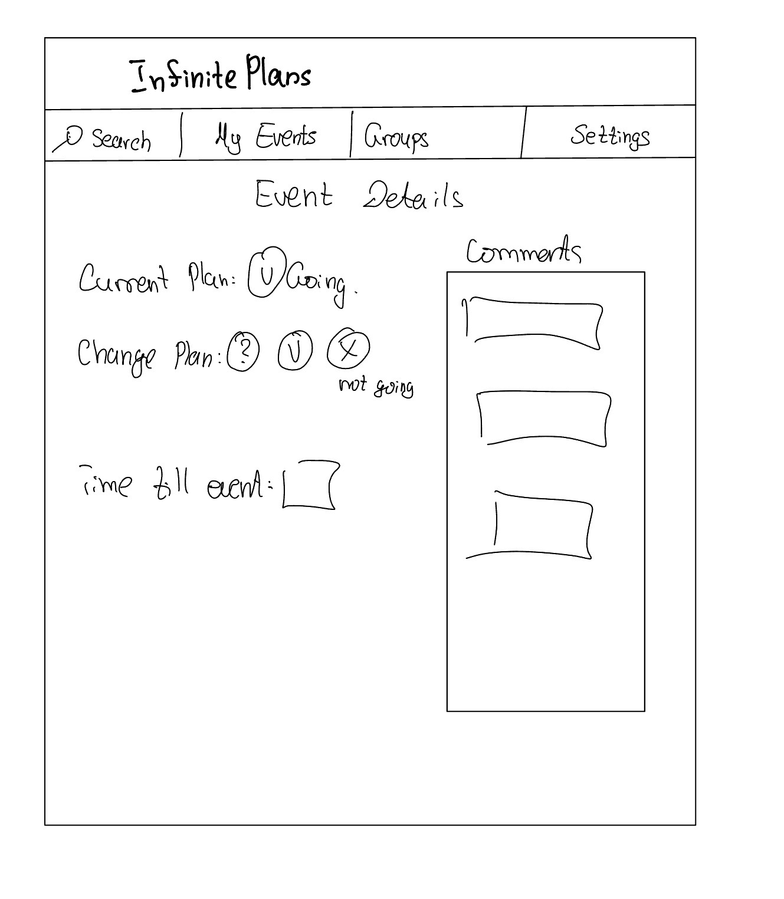

# Infinite Plans Design

## Problem Framing

### Domain

The domain is MIT students and campus events, including club activities, social gatherings, career events, professor talks, and research seminars. Students, clubs, academic departments, fraternities, and living groups organize these events to share knowledge, create opportunities, and bring people together. Students discover events through emails, group chats, and event platforms, and choose which to attend based on their interests and availability.

### Bad Situations

Event announcements at MIT are scattered across different channels. Some events are advertised through dormspam emails, others through group chats or Partiful. Students hear about events from their clubs, fraternities, living groups, academic departments, and friends, but keeping track of them across these channels is difficult. Even with existing campus calendars, students may need to piece together their plans from several sources.

A main problem I want to address is that students hear about events they want to attend but lose track of them before they happen. For example, a student sees an announcement for a professor’s talk, a career event, or a club activity through an email, poster, or group chat. They are interested, but the announcement provides no clear way to save their intention to attend for later. They plan to return to it, but the email gets buried or the message disappears among newer conversations. By the time they remember, the event or its registration deadline has already passed.

Students might take screenshots or send announcements to themselves, but these can also become scattered and forgotten. Even when an event does not require a reservation, students still need a reliable way to keep track of whether they might attend or plan to attend and to find the latest details again.

The difficulty can continue after the event. A student attends a professor’s talk or career event and wants to ask a question, but the session ends before they get the opportunity. They may also think of a question afterward or want to continue a discussion with other attendees, but do not know how to reach them. A student who could not attend may also have no clear place to ask whether materials or another session will be available. When event information and conversations are spread across separate channels, students can struggle both to follow through on their plans and to stay connected afterward.

### Corroboration

Existing platforms provide preliminary evidence that campus event discovery and communication are established needs. The [MIT Events Calendar](https://calendar.mit.edu/) lists events across categories and locations and includes features for expressing interest and sharing events. Engage@MIT, MIT’s official campus community platform, also lists student groups and their events. These sources show that event information is available through multiple campus services, although they do not establish how often students miss events or encounter conflicting details.

There is also evidence that event communication is a recognized problem beyond universities. [Partiful](https://partiful.com/) offers event comments, replies, and messages to guests, including updates about practical details. These features address situations similar to the repeated questions and changing information described above. However, product features alone do not demonstrate the frequency or severity of these problems among MIT students.

In informal conversations, several MIT students have described difficulty discovering and keeping track of campus events. This concern has been especially common among first-year students who are still exploring campus activities and communities. Some students also filter dormspam emails out of their main inbox, making event announcements easier to overlook. These conversations suggest that the problem extends beyond personal experience and can lead students to miss opportunities to participate.

### Workarounds and Comparables

**Dormspam, mailing lists, and group chats.** Organizers use these channels to advertise events to existing communities. Students can ask questions by replying to an email or posting in a chat, but announcements can get buried among unrelated messages. An answer shared in one conversation may not reach students who discovered the event elsewhere. These channels help spread information, but students still have to keep track of events across separate conversations. Some students also filter dormspam emails, so they may never see these event announcements.

**Screenshots, saved messages, and personal calendars.** Students can screenshot announcements, send themselves links, or manually add events to their calendars. These workarounds help them remember their plans, but require individual effort and can leave them with outdated details if an organizer changes the time or location. They also do not provide a shared place to ask questions or continue conversations with other attendees.

**MIT Events Calendar.** The [MIT Events Calendar](https://calendar.mit.edu/) includes academic and nonacademic events, filters by interest and audience, and an “I’m Interested” feature. It already addresses parts of event discovery and tracking. However, many club meetings, private community events, and informal social gatherings are still shared through separate channels. In my experience, the interface also makes marking events less straightforward than I would like, and it does not bring together all the invitations students receive separately from friends, clubs, and living groups.

**Partiful.** [Partiful](https://partiful.com/) supports event invitations, guest responses, comments, replies, and updates to guests. It therefore already addresses several of the communication problems I identified, including providing a place for event-related discussion. However, an event page only helps students once they discover and use it; it does not automatically bring in announcements that remain in dormspam or separate chats. My proposed app would explore combining campus discovery with events from students’ smaller communities and keeping their plans and discussions accessible in one place.

These tools already solve substantial parts of the problem. The gap I want to investigate is whether students still struggle to follow events across them, and whether a shared campus platform would reduce that effort enough to justify using another app.

### Solution Sketch

I propose a web app called **Infinite Plans** where students, clubs, academic departments, FSILGs (fraternities, sororities, and independent living groups), and other living groups can publish events and choose who can see them. Events could include professor talks, career events, workshops, performances, club meetings, and informal gatherings. Organizers could share an event with the entire university or restrict it to selected groups.

Students can discover events in a shared event feed and mark their current attendance intention as **Might Go**, **Going**, or **Not Going**. Events marked **Might Go** or **Going** appear in the student’s **My Events** view. Marking an event **Not Going** removes it from that view while preserving the student’s explicit response.

Each event has one page containing its current details. If those details change, students who marked the event **Might Go** or **Going** can be notified. Event pages may also have commenting enabled so students can ask questions and continue discussions before or after the event.

Students can browse campus groups and request to join groups whose membership requires approval. Group membership can be used to make some events visible only to the intended communities, such as an FSILG event, living-group event, or club-only activity.

The **My Events** page collects a student’s current **Going** and **Might Go** events and includes a calendar view so the student can see how upcoming events fit into their schedule.

For the class project, I would focus on event publishing, attendance marking, group joining, comments, notifications, and the interfaces needed to combine those behaviors. Organizers can continue advertising links through dormspam and existing chats while directing students to one place for current details.

### Stakeholders

**Students.** MIT students discover events, record whether they might attend or plan to attend, keep track of their plans, join campus groups, and participate in event-related discussions.

**Event organizers.** Students and organizations publish events, maintain current event details, choose the intended audience, and optionally enable discussion.

**Campus groups.** Clubs, departments, living groups, FSILGs, and other communities organize events for the wider MIT community or for selected members.

**Group administrators.** People responsible for a group determine its joining policy and approve membership requests when approval is required.

---

## Application Pitch

### Infinite Plans

**Motivation.** MIT students discover events through many disconnected channels and can easily lose track of events they care about or miss later changes to their details.

### One Event, One Place

Infinite Plans gives each event one current page containing its time, location, description, organizer, and audience. Organizers can continue advertising through dormspam, group chats, or other channels, but those announcements can point back to the same event page. If details change, the organizer updates that page rather than relying on students to find a later message. When commenting is enabled, questions and answers can remain attached to the event as well. This reduces fragmented information for students and reduces repeated communication work for organizers.

### My Event Plans

Students can mark events as **Might Go**, **Going**, or **Not Going**. Events marked **Might Go** or **Going** are collected in **My Events**, where students can also view them in a calendar. Students can change their plan later; choosing **Not Going** removes the event from **My Events**. Students who are still interested in attending can receive notifications when relevant details change. This gives students a lightweight way to preserve their plans without manually copying events into several other systems.

### Campus Groups and Private Events

Students can browse MIT groups and join open groups or request access to groups that require approval. Organizers can restrict an event to selected groups, allowing the same application to support public professor talks and career events as well as club meetings, living-group gatherings, and FSILG events. This allows smaller communities to use the same event system without requiring every event to be public.

---

## Concept Design

The application is decomposed into five concepts:

1. `EventPublishing`
2. `EventMarking`
3. `GroupJoining`
4. `Commenting`
5. `Notifying`

Each concept has one primary purpose and defines its own state and actions independently. Application-specific behavior is produced by composing the concepts through reactions.

### EventPublishing

```text
concept EventPublishing

types
  external User
  external Group
  Visibility is PUBLIC or RESTRICTED
  PublicationStatus is DRAFT or PUBLISHED

purpose
  maintain one authoritative description of an event for its intended audience

principle
  If an organizer creates and publishes an event, students can refer to that
  published event for its details; if the organizer later revises it, the same
  event contains the updated details rather than requiring a separate listing.

state
  a set of Events with
    an organizer User
    a title String
    a description String
    a start DateTime
    an end DateTime
    a location String
    a visibility Visibility
    an audience set of Group
    a publicationStatus PublicationStatus
    Rule: start is before end
    Rule: if visibility is RESTRICTED, audience is not empty

actions
  create (
    organizer: User,
    title: String,
    description: String,
    start: DateTime,
    end: DateTime,
    location: String,
    visibility: Visibility,
    audience: set of Group
  ): returns (event: Event)
    where start is before end
      and visibility is PUBLIC or audience is not empty
    then creates a new event with the given information,
      sets its publicationStatus to DRAFT,
      and returns event

  publish (event: Event)
    where event exists
      and publicationStatus of event is DRAFT
    then sets publicationStatus of event to PUBLISHED

  revise (
    event: Event,
    title: String,
    description: String,
    start: DateTime,
    end: DateTime,
    location: String,
    visibility: Visibility,
    audience: set of Group
  )
    where event exists
      and start is before end
      and visibility is PUBLIC or audience is not empty
    then sets the event's title, description, start, end, location,
      visibility, and audience to the given values

  unpublish (event: Event)
    where event exists
      and publicationStatus of event is PUBLISHED
    then sets publicationStatus of event to DRAFT
```

### EventMarking

```text
concept EventMarking

types
  external User
  external Event
  AttendanceIntent is MIGHT_GO or GOING or NOT_GOING

purpose
  prevent events of interest from being lost by preserving a user's current
  attendance intention

principle
  If a user is interested in an event but uncertain, they can mark it MIGHT_GO.
  If they later decide to attend, they can change the mark to GOING. If they
  decide against attending, they can change it to NOT_GOING, preserving their
  explicit decision while no longer treating the event as one of their plans.

state
  a set of Marks with
    a user User
    an event Event
    an intent AttendanceIntent
    unique user and event

actions
  mark (user: User, event: Event, intent: AttendanceIntent)
    where no mark exists for the given user and event
    then creates a new mark with the given user, event, and intent

    where a mark exists for the given user and event
    then sets intent of that mark to the given intent
```

In Infinite Plans, **My Events** is a view over marks whose intent is `MIGHT_GO` or `GOING`. A `NOT_GOING` mark is retained by the concept but is excluded from **My Events**.

### GroupJoining

```text
concept GroupJoining

types
  external User
  external Group
  JoiningPolicy is OPEN or APPROVAL

purpose
  let communities control who is recognized as a member

principle
  If a group is open, a user can join it directly. If a group requires
  approval, a user requests to join and becomes a member only if that request
  is approved. A member can later leave the group.

state
  a set of Groups with
    a policy JoiningPolicy

  a set of JoinRequests with
    a user User
    a group Group
    unique user and group

  a set of Memberships with
    a user User
    a group Group
    unique user and group

actions
  setPolicy (group: Group, policy: JoiningPolicy)
    then ensures group is recorded
      and sets policy of group to the given policy

  join (user: User, group: Group)
    where group exists
      and policy of group is OPEN
      and no membership exists for the given user and group
    then creates a membership for the given user and group

  requestJoin (user: User, group: Group): returns (request: JoinRequest)
    where group exists
      and policy of group is APPROVAL
      and no membership exists for the given user and group
      and no join request exists for the given user and group
    then creates a join request for the given user and group
      and returns request

  approve (request: JoinRequest)
    where request exists
    then creates a membership for the request's user and group
      and removes request

  reject (request: JoinRequest)
    where request exists
    then removes request

  leave (user: User, group: Group)
    where a membership exists for the given user and group
    then removes that membership
```

### Commenting

```text
concept Commenting

types
  external User
  external Subject
  CommentingStatus is ENABLED or DISABLED

purpose
  keep discussion about a subject in one persistent shared place

principle
  If commenting is enabled for a subject, a user can add a comment and another
  user can reply to it; the reply remains associated with the original subject
  and comment so the conversation can be followed later.

state
  a set of Subjects with
    a status CommentingStatus

  a set of Comments with
    an author User
    a subject Subject
    a content String
    an optional parent Comment
    a createdAt DateTime

actions
  enable (subject: Subject)
    then ensures subject is recorded
      and sets status of subject to ENABLED

  disable (subject: Subject)
    then ensures subject is recorded
      and sets status of subject to DISABLED

  add (
    user: User,
    subject: Subject,
    content: String
  ): returns (comment: Comment)
    where subject exists
      and status of subject is ENABLED
    then creates a new comment with the given user, subject, and content,
      with no parent and createdAt equal to the current time,
      and returns comment

  reply (
    user: User,
    parent: Comment,
    content: String
  ): returns (comment: Comment)
    where parent exists
      and the subject of parent has status ENABLED
    then creates a new comment whose subject is the subject of parent,
      whose parent is the given parent,
      whose author is the given user,
      whose content is the given content,
      and whose createdAt is the current time,
      and returns comment

  remove (comment: Comment)
    where comment exists
    then removes comment
```

In Infinite Plans, `Subject` is instantiated with `Event`. The **Enable commenting** control in the create-event interface invokes `Commenting.enable(event)` for the newly created event.

### Notifying

```text
concept Notifying

types
  external User
  external Subject
  NotificationStatus is UNREAD or READ

purpose
  provide users with timely awareness of occurrences relevant to them

principle
  If an occurrence is relevant to a user, a notification can be created for
  that user; it remains unread until the user acknowledges it by marking it read.

state
  a set of Notifications with
    a recipient User
    a subject Subject
    a message String
    a status NotificationStatus
    a createdAt DateTime

actions
  notify (
    user: User,
    subject: Subject,
    message: String
  ): returns (notification: Notification)
    then creates a notification with recipient user,
      subject subject,
      message message,
      status UNREAD,
      and createdAt equal to the current time,
      and returns notification

  markRead (notification: Notification)
    where notification exists
      and status of notification is UNREAD
    then sets status of notification to READ
```

---

## Essential Reactions


### Notify interested users when event details change

```text
when
  EventPublishing.revise(event, ...)

where
  EventMarking has a mark with event event,
    user user,
    and intent MIGHT_GO or GOING

then
  Notifying.notify(
    user,
    event,
    "Details for an event in your plans have changed."
  )
```

A user who marked the event `NOT_GOING` is not notified about later event-detail changes.

### Notify interested users when an event is unpublished

```text
when
  EventPublishing.unpublish(event)

where
  EventMarking has a mark with event event,
    user user,
    and intent MIGHT_GO or GOING

then
  Notifying.notify(
    user,
    event,
    "An event in your plans is no longer published."
  )
```

### Notify a user when a group join request is approved

```text
when
  GroupJoining.approve(request)

where
  request was for user and group

then
  Notifying.notify(
    user,
    group,
    "Your request to join the group was approved."
  )
```

### Notify the author of a comment when someone replies

```text
when
  Commenting.reply(user, parent, content): (reply)

where
  parent has author recipient
  and recipient is not user

then
  Notifying.notify(
    recipient,
    subject of parent,
    "Someone replied to your comment."
  )
```

### Notify members when a restricted group event is published

```text
when
  EventPublishing.publish(event)

where
  event has visibility RESTRICTED
  and group is in audience of event
  and GroupJoining has a membership with user user and group group

then
  Notifying.notify(
    user,
    event,
    "A new event was published for one of your groups."
  )
```

---

## Role of the Concepts

`EventPublishing` creates and maintains `Event` individuals. `EventMarking` treats those events as external identities and records only a user's attendance intention toward them; it does not depend on an event's title, time, location, or publishing state.

`GroupJoining` independently records membership in campus groups. `EventPublishing` may associate a restricted event with one or more external `Group` identities, while application-level composition uses `GroupJoining` membership to determine which users should be shown those restricted events. The publishing concept itself does not inspect membership state.

`Commenting` is generic over `Subject`. In Infinite Plans, its `Subject` type is instantiated with `Event`, so event discussion is possible without making the generic commenting behavior depend on event details. Commenting can be enabled or disabled for an event independently of publishing it.

`Notifying` is also generic over `Subject`. In this application, a notification may concern an `Event` or a `Group`. Reactions decide which occurrences are important enough to create notifications.

The **My Events** interface is not a separate concept. It is a view over `EventMarking`: it shows events marked `MIGHT_GO` or `GOING` and excludes events marked `NOT_GOING`. Similarly, the calendar is a presentation of those marked events together with their published dates rather than a separate behavioral concept.

---

## UI Sketches

The sketches are intentionally low-fidelity and focus on the application's primary interactions rather than visual styling.

### 1. Event Feed / Discovery

The event feed brings events from different campus communities into one place. Each event exposes the three `EventMarking` choices: **Going**, **Might Go**, and **Not Going**, as well as access to comments. The interface also allows switching between feed and grid presentations and provides access to event creation.



### 2. Group Discovery

Students can browse groups by category, such as clubs, departments, and FSILGs, or search for a particular group. Selecting a group opens its group detail view.



### 3. Group Details and Joining

The group detail view provides a description, shows the group's events, explains who can join, and exposes the appropriate join action. For a group with approval-controlled membership, the student can submit a join request.



### 4. Create Event

An organizer can enter the event name, description, date, and intended audience. The audience may be everyone or selected groups. The organizer can also enable commenting before publishing the event.



### 5. My Events

`My Events` separates the student's current plans into **Going** and **Might Go**. The student can change an existing plan. Choosing **Not Going** removes the event from this view because `My Events` includes only `GOING` and `MIGHT_GO` marks. The calendar presents the same upcoming plans by date.



### 6. Event Details

The event detail page shows the user's current plan and allows it to be changed among **Might Go**, **Going**, and **Not Going**. It also shows time remaining until the event and, when commenting is enabled, the persistent event discussion.



---

## User Journey

Lizi is an MIT student who hears about campus activities through several mailing lists and group chats. She often sees events while she is busy, thinks that she may want to attend, and then loses the original message before making a decision.

While browsing Infinite Plans, Lizi opens the event feed shown in **Sketch 1** and sees a concert she is interested in. She is not yet sure whether she can attend, so she marks it **Might Go**. The event is now included in **My Events** rather than depending on Lizi remembering which message originally advertised it.

Lizi is also interested in Rocket Club. She opens the group-discovery page in **Sketch 2**, selects Rocket Club, and reaches the group page in **Sketch 3**. Because the group requires approval, she submits a request to join. When the request is approved, she receives a notification and can see restricted events intended for members of that group.

Later, Lizi opens **My Events** in **Sketch 5**. The concert appears in the **Might Go** section alongside other events she is considering, while events she has committed to appear under **Going**. She decides that another event no longer fits her schedule and changes it to **Not Going**; it disappears from **My Events**. The explicit `NOT_GOING` mark remains recorded, distinguishing that decision from an event she has never considered.

The day before the concert, its organizer changes an event detail. Because Lizi still has the event marked **Might Go**, she receives a notification rather than having to find the original announcement again. She opens the event detail page shown in **Sketch 6**, sees the current information, and changes her plan from **Might Go** to **Going**.

Commenting is enabled for the event, so Lizi can also read a question from another student and the organizer's response on the same event page. When the day arrives, she can find the event under **Going** in **My Events** and see it in the calendar instead of reconstructing her plans from email, screenshots, and chat history.

This journey addresses the central bad situation: a student can discover an event through one channel, preserve their intention toward it, receive important changes, and return to one current source of information later.
"""
